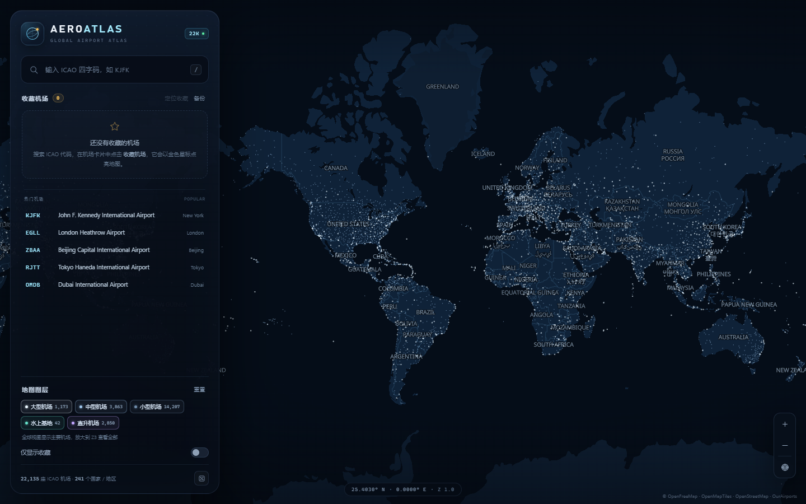
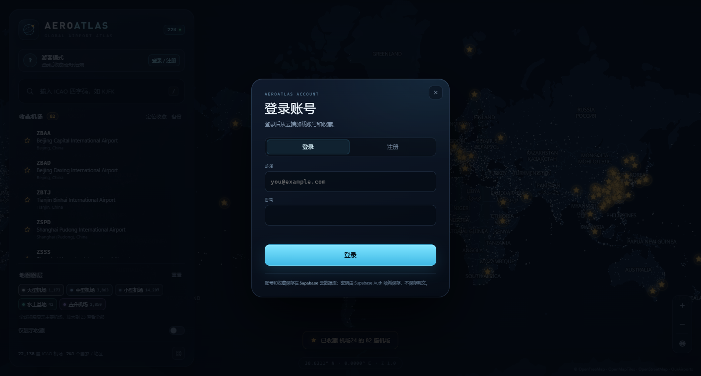
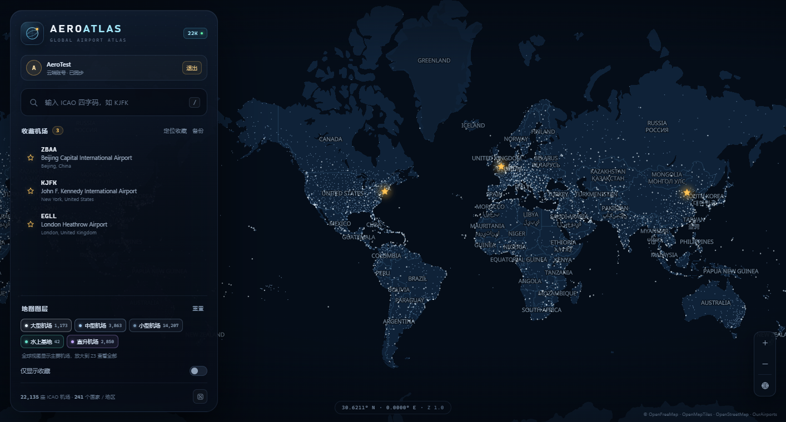
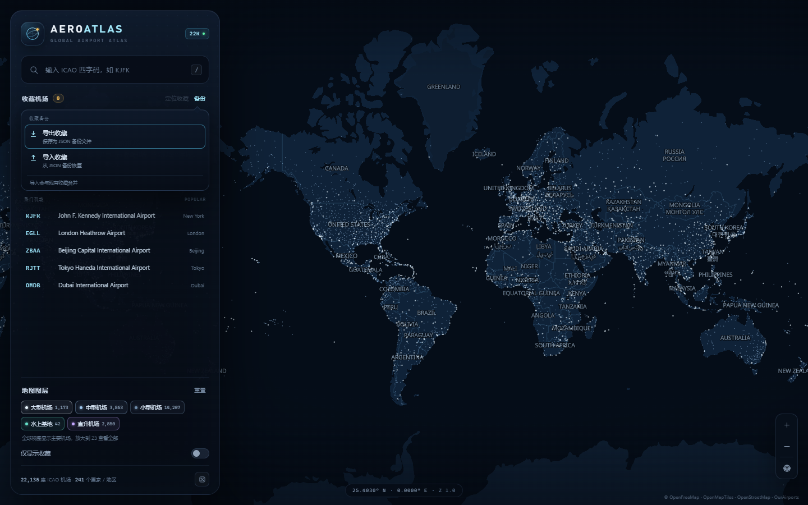
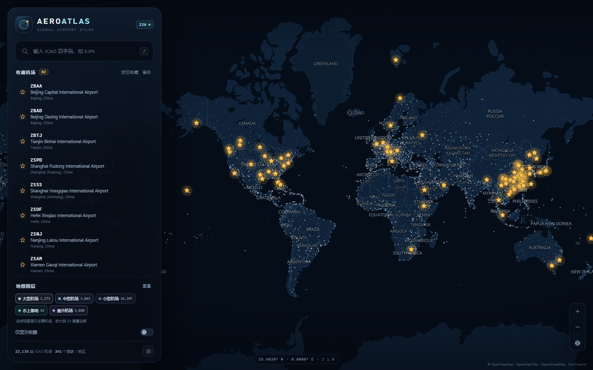

# AeroAtlas · 全球机场图鉴

一个 Volanta 风格的全球机场地图网页：全屏暗色航图、全球机场点阵、ICAO 四字码搜索、收藏与金色星标高亮。



## 功能

- **全球机场地图**：收录 22,135 座拥有 ICAO 四字码的机场（241 个国家 / 地区），按大型 / 中型 / 小型 / 水上基地 / 直升机场分层渲染。全球视图先显示大型 / 中型机场，放大到 Z3 后自动加入全部机场；支持缩放、拖拽与全球视图。
- **ICAO 搜索**：输入四字码即时匹配，支持前缀（如 `EG` 列出伦敦机场群）；同时支持机场名称、城市和 IATA 代码。`Enter` 直接打开最佳结果。
- **机场详情**：大号 ICAO、IATA、城市/国家、经纬度、海拔、定期航班状态，以及跑道长度与道面；地图同步绘制所选机场的真实跑道。
- **收藏系统**：机场卡片或搜索结果右侧的星标即可收藏；游客模式写入浏览器 `localStorage`，登录后同步到当前云端账号。
- **云端账号**：基于 Supabase Auth + Postgres 的登录 / 注册，收藏夹与账号绑定；密码哈希由 Supabase Auth 管理，`profiles` 表通过 RLS 限制为本人读写。
- **收藏备份**：侧栏收藏标题右侧的「备份」菜单可一键导出 / 导入 JSON 文件，导入会与现有收藏合并，适合换电脑或清理浏览器前留档。
- **地图特殊显示**：收藏机场以**金色星标 + 呼吸脉冲光环**显示，高缩放时附带 ICAO 标签；「仅显示收藏」会把地图聚焦到全部收藏。
- **收藏夹面板**：收藏列表、最近查看、热门机场、一键定位收藏。
- **响应式**：桌面为左侧控制台 + 右侧机场卡片；移动端自动变为底部抽屉与底部卡片。
- **可分享链接**：`?icao=KJFK` 直接打开机场；`?fav=KJFK,EGLL&favonly=1` 分享收藏视图。
- **离线兜底**：底图瓦片不可达时自动切换为本地 Natural Earth 海岸线底图，机场数据与搜索始终可用。

## 运行

### 线上

直接打开 **https://cxdxd.github.io/map/**。账号由 Supabase 云端提供，登录 / 注册后收藏会跟随账号。

### 本地入口（可选）

双击 **`start.bat`**。它会用内置的 Python 运行时在后台启动本地静态服务，等接口就绪后自动打开：

```text
http://127.0.0.1:8000/
```

如果浏览器显示 `ERR_CONNECTION_REFUSED`，说明后台服务没有运行：再双击一次 `start.bat`，等 1-2 秒后刷新页面即可。

停止服务：双击 **`stop-server.bat`**。浏览器可以随时关闭，服务在后台继续运行；下次双击 `start.bat` 会复用已运行的服务。



登录后，侧栏会显示云端账号和同步状态：



云端账号不依赖这个本地服务；`start.bat` 只是本地入口，并保留 `server.py` 作为离线 / 旧账号兜底。

### 游客模式

不登录也可以使用地图、搜索、收藏和备份；收藏只保存在当前浏览器。

> 底图瓦片、字体与图标来自 OpenFreeMap（在线），因此首次打开需要联网；机场索引、搜索和收藏数据由本地脚本与 Supabase 提供。

## 云端账号（Supabase）

- 项目 URL：`https://pinfvtiqssfzwaxnpfxa.supabase.co`
- 前端配置：`data/cloud-config.js`（只放 Project URL 和 **publishable / anon** 公开 key）
- 登录方式：**邮箱 + 密码**；注册时可设置显示名称。
- 密码保存在 Supabase Auth 的 `auth.users` 中，以哈希形式管理；网页不接触密码哈希。
- 收藏保存在 Postgres 的 `public.profiles.favorites`（JSONB），RLS 策略只允许 `auth.uid() = id` 的本人读写。
- 建表 SQL：`cloud/supabase-schema.sql`
- 接入说明：`cloud/SETUP.md`
- 注册后默认需要点击邮件里的确认链接；可在 Supabase Authentication → URL Configuration 把 Site URL 设为 `https://cxdxd.github.io/map/`，并加入 `http://127.0.0.1:8000/**`。
- 不要把 **service_role / secret key** 放进网页或仓库；前端只使用 publishable / anon key，RLS 负责隔离数据。
- 旧的本地账号仍保留在 `storage/`（不会上传）；本地旧账号的收藏已导出到 `storage/cloud-migration-favorites.json`，登录云端账号后可用「备份 → 导入收藏」迁移。
- 本地账号兜底仍由 `server.py` 提供，账号文件为 `storage/accounts.json`、会话为 `storage/sessions.json`；`storage/` 与 `runtime/` 都在 `.gitignore` 中。

## 操作

| 操作 | 说明 |
| --- | --- |
| `/` 或 `Ctrl/Cmd + K` | 聚焦搜索框 |
| `↑` / `↓` | 切换搜索结果 |
| `Enter` | 打开当前结果 |
| `Esc` | 关闭搜索面板 / 机场卡片 |
| `F` | 收藏或取消收藏当前机场 |
| 点击地图空白 | 关闭机场卡片 |
| 点击星标 | 打开对应收藏机场 |

## 数据

- 机场、跑道、国家： [OurAirports](https://ourairports.com/data/)（公共领域），构建快照 2026-10-25。
- 底图：[OpenFreeMap](https://openfreemap.org/) / [OpenMapTiles](https://openmaptiles.org/) / [OpenStreetMap](https://www.openstreetmap.org/copyright)。
- 离线海岸线：[Natural Earth](https://www.naturalearthdata.com/)（公共领域）。
- 仅纳入 `gps_code` 或 `ident` 为合法四字母 ICAO 代码、且未关闭的机场。

## 收藏数据与备份

游客收藏保存在浏览器的 **localStorage** 中，键名为 `aeroatlas.favorites.v2`；最近查看的键名为 `aeroatlas.recent.v1`。登录后，收藏改由 Supabase 的 `profiles.favorites` 提供并同步，不再依赖浏览器本地键；游客收藏仍保留，退出后恢复。



**推荐备份方式**：点击侧栏「收藏机场」右侧的「备份」→「导出收藏」，会下载一个 `aeroatlas-favorites-YYYY-MM-DD.json` 文件；需要恢复时点击「导入收藏」选择该文件。导入会与现有收藏合并，不会删除已有收藏；登录状态下会同步到云端账号。

### 内置的「机场24」收藏

本地副本内置了 `data/airports24-seed.js`：在 `file://`、`localhost` / `127.0.0.1` 或局域网地址首次打开时，会把 `机场24.docx` 中的 **82 座机场**合并进收藏（不覆盖原有收藏），之后即使删除某座也不会再自动加回。该预置只对本地 / 局域网地址生效，公开域名不会自动添加；部署到公开域名后如需这份收藏，点击「备份」→「导入收藏」，选择 `airports24-favorites.json` 即可。



需要注意，**游客收藏**按来源（origin）隔离；登录后的云端收藏跟随账号，不受来源影响：

- `file:///.../index.html`
- `http://localhost:8000/`
- `http://127.0.0.1:8000/`

这是三个不同的来源，收藏互不相通；无痕/InPrivate 模式、清理“Cookie 及其他网站数据”、更换浏览器或配置文件，都会让收藏不可见。

Chromium 系浏览器的物理位置：

- Edge：`%LOCALAPPDATA%\Microsoft\Edge\User Data\Default\Local Storage\leveldb`
- Chrome：`%LOCALAPPDATA%\Google\Chrome\User Data\Default\Local Storage\leveldb`

控制台备用方式（在页面按 F12 打开控制台）：

```js
// 导出：把当前收藏 JSON 复制到剪贴板
copy(localStorage.getItem('aeroatlas.favorites.v2') || '[]')

// 恢复：粘贴备份的 JSON 并刷新
const v = prompt('粘贴收藏 JSON'); if (v) { localStorage.setItem('aeroatlas.favorites.v2', v); location.reload(); }
```

## 重新构建数据

```bash
python tools/fetch_data.py      # 下载 OurAirports CSV 与 Natural Earth 海岸线
python tools/build_data.py      # 生成 data/airports.js 与 data/basemap.js
python tools/prepare_basemap.py # 下载 OpenFreeMap 暗色样式并调成深蓝配色
```

`data/airports.js` 采用紧凑数组格式以压缩体积：

```
[icao, name, city, isoCountry, type, elevationFt, iata, lat, lon, scheduled, runways]
```

## 目录

```
index.html               页面结构
assets/style.css         视觉样式
assets/app.js            地图、搜索、收藏、云端/本地账号逻辑
data/cloud-config.js     Supabase Project URL + publishable key（公开）
cloud/                   Supabase 建表 SQL 与接入说明
server.py                本地静态服务 + 旧账号 / 离线兜底 API
start.bat                启动本地入口（调用 start.ps1）
start.ps1                后台启动服务、等待就绪并打开浏览器
stop-server.bat          停止本地服务
storage/                 本地旧账号、会话和启动日志（不要上传）
runtime/                 内置 Windows Python 3.12 运行时（不要上传）
data/airports.js         22,135 座机场 + 跑道索引
data/airports24-seed.js  机场24.docx 的 82 座本地预置收藏
data/basemap.js          离线海岸线兜底
data/basemap-style.js    调色后的 OpenFreeMap 暗色样式
airports24-favorites.json 机场24 收藏备份（可通过「备份」导入）
vendor/                  MapLibre GL JS、Supabase JS
tools/                   数据抓取与构建脚本
shots/                   预览截图
```

## 性能优化

- 全球视图只渲染大型 / 中型机场（约 5 千座），缩放到 Z3 以上自动加入全部 22,135 座，避免低缩放时 2 万多个点拖慢帧率。
- 机场点合并为单个 GPU 图层；底图从 47 层精简到 27 层，移除建筑、铁路、道路文字等非必要图层。
- 关闭 MSAA，HiDPI 屏幕的内部渲染分辨率最高 1.5×；移除侧栏 / 卡片的实时背景模糊。
- 悬停查询与 HUD 更新做节流；缩放时不再逐帧写 DOM；没有收藏时不计算标记位置。
- 如需进一步提速，可把 `assets/app.js` 中的 DPR 上限 `1.5` 改为 `1.25`，或提高 `MINOR_AIRPORT_MIN_ZOOM` 的阈值。

## 说明

- 搜索索引包含 ICAO、IATA、英文机场名与城市；当前数据源的机场名为英文。
- 地图样式基于 OpenFreeMap Dark，并按 AeroAtlas 的深蓝 / 青色 / 金色配色重调。
- 本项目为 Volanta 风格的独立练习作品，与 Volanta 官方无关。
